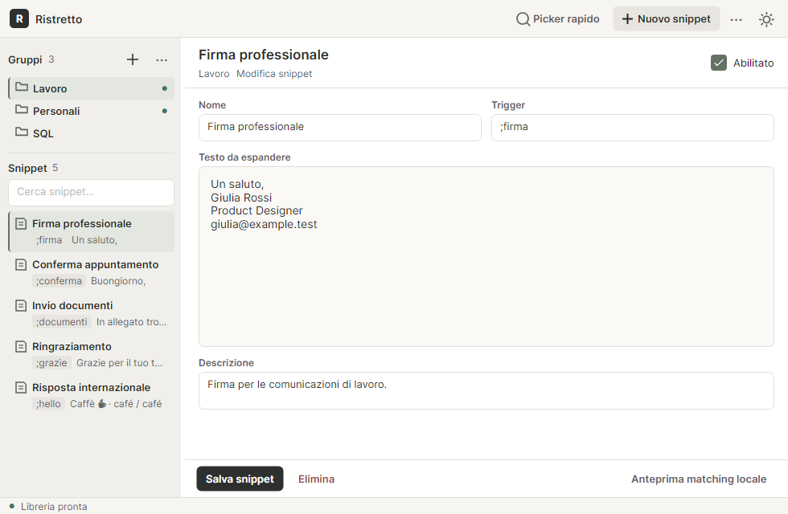
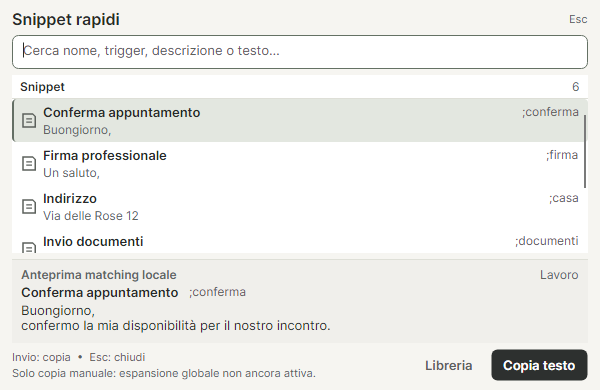

# Ristretto

## Screenshot

Anteprime della **GUI Preview 9, Alpha 7**, precedenti a Inserisci, alle hotkey per snippet e al pulsante Registra….

**Libreria degli snippet**

**Picker di ricerca**

La scritta «Invio: copia» nell'immagine è storica: oggi Invio inserisce il risultato selezionato. [Altre anteprime e provenienza delle immagini](design/README.md).

## Cos'è Ristretto

Ristretto è un'applicazione desktop per conservare e riutilizzare testi frequenti: firme, risposte, indirizzi, comandi e modelli di messaggio.

Gli snippet sono organizzati in gruppi e salvati localmente. Su Windows puoi inserirli nell'applicazione in cui stai scrivendo tramite una combinazione di tasti o scegliendoli dal picker.

**Versione attuale: 3.9.0-alpha.20.26.** Il progetto è in sviluppo, realizzato in C#/.NET 10, Avalonia e SQLite. La prima piattaforma di utilizzo è Windows; le funzioni native per Linux e macOS sono pianificate.

**L'espansione automatica mentre digiti un trigger, per esempio `;firma`, è ancora in sviluppo.** Oggi il richiamo avviene con un comando esplicito.

## Come funziona

### 1. Crea uno snippet

Crea un gruppo, premi **Nuovo snippet**, compila nome, trigger e testo, poi premi **Salva**. Il trigger identifica lo snippet e consente di cercarlo; al momento digitarlo in un'altra applicazione non produce un'espansione automatica.

### 2. Richiamalo con una hotkey

Nel campo hotkey dello snippet premi **Registra…**, poi premi la combinazione desiderata. La form mostra i tasti rilevati, per esempio **ALT + CTRL + SHIFT + B**. Rilasciali, scegli **Usa combinazione** e salva lo snippet.

Con Ristretto in esecuzione, porta il cursore nell'applicazione di destinazione e premi la combinazione. Il contenuto viene incollato senza aprire il picker.

Una combinazione può appartenere a un solo snippet e non può coincidere con quella del picker. Un campo vuoto o `None` rimuove l'associazione dopo il salvataggio. Snippet e gruppi disabilitati non attivano hotkey.

### 3. Oppure usa il picker

Aprilo con **Ctrl+Shift+Space**, cerca uno snippet e usa le frecce per selezionarlo. **Invio** o **Inserisci** inseriscono il risultato selezionato; **Copia testo** lo mette soltanto negli appunti. **Esc** chiude il picker.

Per inserire in un'altra applicazione, richiamalo mentre il cursore è già nel campo di destinazione. La combinazione del picker si cambia nelle impostazioni.

L'inserimento usa gli appunti, che rimangono contenenti lo snippet. Il richiamo di base in **Blocco note Windows è stato confermato dall'utente**; altri editor e i casi avanzati sono ancora da qualificare. L'acquisizione tramite la nuova form Registra… deve ancora essere provata sul desktop. [Funzioni disponibili e verifiche](docs/CURRENT_STATE.md).

## Installazione

La consegna attuale è uno **ZIP completo dei sorgenti**, da compilare. Installer e pacchetto eseguibile pronto all'uso sono pianificati.

1. Installa l'[SDK .NET 10 dalla pagina ufficiale Microsoft](https://dotnet.microsoft.com/en-us/download/dotnet/10.0).
2. Estrai lo ZIP in una cartella nuova.
3. Apri PowerShell nella cartella che contiene `Ristretto.sln` ed esegui:

~~~powershell
.\scripts\validate.cmd
~~~

Il risultato atteso è **GATE CORE: PASS**. Il primo ripristino delle dipendenze richiede accesso a NuGet, oppure una cache locale già disponibile.

Avvia quindi Ristretto:

~~~powershell
dotnet run --project src/TextExpander.Desktop/TextExpander.Desktop.csproj -c Release
~~~

Per l'uso Windows e il gate CORE basta .NET: **Python e Node.js non sono richiesti**. Node.js serve soltanto alle verifiche dell'estensione VS Code facoltativa.

## Aggiornamento

1. Nell'applicazione apri il menu **⋯ → Backup** e conserva il backup indicato nella barra di stato.
2. Esci da Ristretto tramite **Esci** nella tray. Chiudere la finestra su Windows può lasciarlo in esecuzione.
3. Estrai il nuovo ZIP in una **cartella nuova**, senza unirlo alla versione precedente.
4. Esegui `.\scripts\validate.cmd` e avvia la nuova versione con il comando indicato sopra.
5. Controlla libreria, impostazioni e una hotkey su un documento di prova.

La cartella dei dati è separata dai sorgenti: con l'avvio normale la nuova versione riutilizza il profilo esistente.

Se usi `--data-dir`, riutilizza **lo stesso percorso assoluto** anche dopo l'aggiornamento. Un percorso relativo a una nuova cartella dei sorgenti può aprire una libreria diversa.

Dalla Alpha 20.25 il database usa lo **schema 2**. Per tornare a una versione che supporta solo lo schema 1 serve un backup compatibile precedente alla migrazione. [Dati, backup e ripristino](docs/INSTALLATION_AND_UPDATE.md).

## Dati e backup

Su Windows il profilo normale si trova in:

~~~text
%LOCALAPPDATA%\TextExpanderStudio
~~~

Contiene `library.db` e la cartella `Backups`. Usa **Backup** e **Ripristina** dal menu dell'applicazione; l'export JSON serve a scambiare snippet, mentre il backup SQLite conserva libreria e impostazioni.

Per provare Ristretto con una libreria separata:

~~~powershell
dotnet run --project src/TextExpander.Desktop/TextExpander.Desktop.csproj -c Release -- --data-dir "$env:LOCALAPPDATA\Ristretto-Prova"
~~~

[Guida ai profili e all'aggiornamento](docs/INSTALLATION_AND_UPDATE.md).

## Stato e prossimi passi

La baseline Alpha 20.26 ha superato **846 test xUnit**, **32 test Node** e il gate CI anche da ZIP estratto in una cartella nuova. Questi risultati precedono la presente revisione della documentazione.

I prossimi passi sono verificare sul desktop la form Registra…, completare i controlli di affidabilità del flusso manuale e qualificare la provenienza dell'input prima della prima espansione automatica.

- [Roadmap dettagliata](docs/ROADMAP.md)
- [Stato corrente](docs/CURRENT_STATE.md)
- [Changelog](CHANGELOG.md)
- [Compilazione e test](docs/BUILD_AND_TEST.md)
- [Indice della documentazione](docs/INDEX.md)

## Licenza

La licenza del progetto deve ancora essere scelta e aggiunta al repository. [Decisione aperta e dipendenze](docs/OPEN_SOURCE_LICENSE_DECISION.md).
