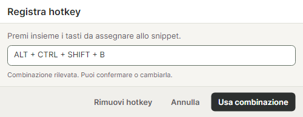
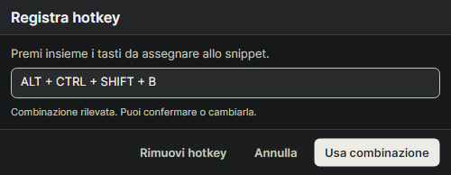

# Alpha 20.29 — Form hotkey coerente con la libreria

Registra hotkey usa ora lo stile `compact` condiviso da libreria e picker. Le metriche sono in `App.axaml`, senza font e bordi speciali nel costruttore della form.

| Elemento | Aspetto aggiornato |
| --- | --- |
| Testo e combinazione | 13 DIP, come i campi compatti; eliminato il display da 23 DIP |
| Titolo | 16 DIP SemiBold, come il titolo del picker |
| Indicazioni di stato | Classe `field-hint` da 11 DIP condivisa con il campo hotkey della libreria |
| Pulsanti | Stessi stili compact/primary/ghost: minimo 32 DIP, padding 11×6, raggio 6 |
| Campo | Minimo 34 DIP, padding 10×6, raggio 6, bordo da 1 DIP e colori di input/focus del tema |
| Spazi | Padding di 12 DIP, distanza di 8 fra i contenuti e 6 fra le azioni; pulsanti su più righe se necessario |

Le istruzioni sono più brevi nelle cinque lingue e compaiono una sola volta. La riga di stato ha uno spazio riservato anche in attesa, per evitare il cambio di altezza quando compare la conferma. Finestra normale da 500 DIP, minimo 440; testo lungo e azioni restano adattabili.

## Anteprime aggiornate

Sono render dei controlli reali, prodotti **fuori schermo con Avalonia/Skia**, senza finestre Windows, database, appunti o registrazioni native. Non sono screenshot del desktop né una prova DPI.





## Come ripetere il controllo

```powershell
dotnet run -c Release --project tools/Ristretto.UiReview -- --output .local-cache/hotkey-review-nuova --hotkey-only
```

La cartella deve essere nuova. Il comando genera 80 PNG e `review.json`: cinque lingue × due temi × larghezza normale/minima × attesa/tasti premuti/pronta/non valida. Verifica che le azioni siano contenute nel client. Il backend Headless 11.3.22 è una dipendenza solo dello strumento, allineata ad Avalonia.

L'acquisizione, Tab/Shift+Tab, annullamento, rimozione e salvataggio mantengono il flusso precedente, coperto dai 50 casi esistenti della cattura. [Verifiche della release](../reports/ALPHA20_29_CHECKS.md).
