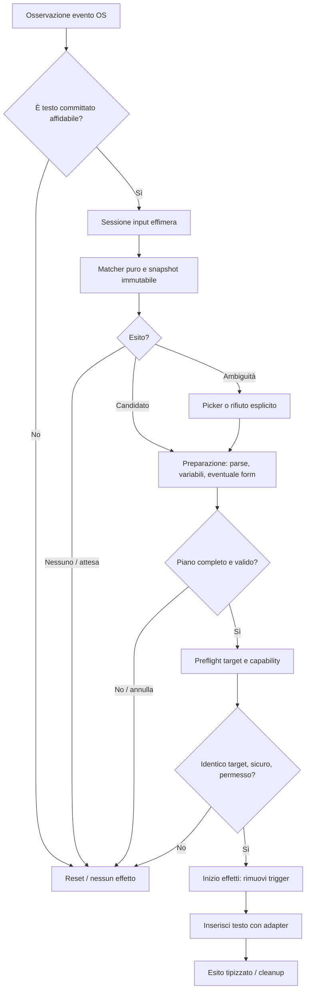

# Raffinamento v2.6 — First effect boundary e fallimenti parziali

Il piano preparato è distinto dall'effetto nativo. Prima del primo possibile cambiamento eseguire [preflight](OUTPUT_COORDINATION.md): stato IME, protezione, target/epoch, capacità di cancellazione e inserimento; effettuare un nuovo controllo a ridosso dell'effetto, senza promettere atomicità contro cambi di focus successivi. Dopo Backspace/paste/iniezione potenzialmente inviati, non effettuare retry/undo impliciti. `LastReachedStage` e `MayHaveModifiedTarget` guidano `InsertionOutcome`. `SubmittedUnverified` **non** è `VerifiedComplete`.

La clipboard è un lease best-effort: ripristino **solo** quando ownership è verificabile e invariata; se l'utente copia altro, mantenere la nuova copia. Vedi [ADR-0005 proposto](adr/ADR-0005-OUTPUT-COMMIT-AND-CLIPBOARD.md).

---

# Ciclo di vita dell'espansione — modello operativo v2.4

> Documento canonico dei **flussi e degli stati**, in fase di studio. Non rappresenta codice compilato o funzionamento certificato in tutti i sistemi. [Modello](DOMAIN_MODEL.md) · [Adapter](PLATFORM_ADAPTER_CONTRACTS.md) · [Test](DOMAIN_TEST_PLAN.md).

## 1. Il flusso end-to-end

Le frecce rappresentano condizioni logiche, non latenze né capacità dimostrate. **La race dopo `Preflight` non può essere eliminata universalmente.** Il percorso picker manuale **non** deve cancellare un trigger che non è stato digitato nel target.

## 2. Stati di un tentativo (durata breve)

| Stato | Ingresso | Uscite lecite | Effetti permessi |
|---|---|---|---|
| `Observing` | backend disponibile | `Matching`, `Suppressed`, `Aborted` | nessuno |
| `Matching` | committed text e target epoch coerenti | `Waiting`, `Preparing`, `Ambiguous`, `Aborted` | nessuno |
| `Waiting` | prefisso o delimitatore atteso | `Matching`, `Aborted` | nessuno |
| `Preparing` | candidato scelto | `Ready`, `Cancelled`, `Blocked` | UI/form e letture autorizzate; nessuna modifica target |
| `Ready` | `ExpansionPlan` immutabile | `Preflight`, `Aborted` | nessuno |
| `Preflight` | target token presente | `Performing`, `Blocked`, `UncertainNoChange` | verifiche; nessuna cancellazione |
| `Performing` | prima modifica target | `SubmittedUnverified`, `VerifiedComplete`, `PartialFailure`, `UnknownAfterEffects` | cancellazione/inserimento |
| Terminale | risultato tipizzato | nuovo tentativo distinto | nessun retry implicito |

Il coordinatore `ExpandText` garantisce **un tentativo attivo alla volta per la destinazione**, con cancellazione/cleanup deterministici e guard per evitare che gli eventi simulati generino nuovi trigger. Non usare un mutex che blocca l'hook globale durante operazioni lente: bufferizzare solo entro limiti e degradare con trasparenza.

## 3. Esempi concreti

### F-01 — trigger semplice e sicuro

Digitazione `:firma`, backend documenta committed text, snapshot `revision=21`, match univoco, template literal pronto. `Preflight` ritrova stesso focus. L'adapter rimuove lo span con una strategia qualificata e invia testo. Se non dispone di una prova di lettura del risultato nell'editor, restituisce `SubmittedUnverified`, **non** `VerifiedComplete`.

### F-02 — ambiguità `:sig` e `:signature`

Con attivazione immediata, `:sig` è prefisso di un altro trigger: segnalarlo in editor e sospendere/impedire l'espansione in base alla policy. Non scegliere un trigger casualmente né affermare che “vince il più lungo” prima che l'utente possa materialmente digitarlo.

### F-03 — trigger dopo spazio, spazio mantenuto

Per `OnDelimiter` lo spazio digitato è riconosciuto come delimitatore; solo l'adapter può determinare la sequenza di rimozione affidabile. `Keep`/`Consume` deve essere parte del match e del piano. Eventuale reinserimento spazio dopo il testo non è un'aggiunta invisibile: deve essere specificato e testato.

### F-04 — variabile che apre dialog

La finestra di input viene aperta **prima** degli effetti. Il target originario è identificato da un token; dopo la chiusura del form avviene un nuovo `Preflight`. Se il focus cambia, nessun trigger viene cancellato e il piano viene scartato. Non inserire un `Sleep(300)` come sostituto di una verifica.

### F-05 — emoji composta come trigger o output

`👨‍👩‍👧‍👦` può essere un singolo grapheme, ma molte unità UTF-16 e più scalari; non calcolare le cancellazioni usando lunghezze di `string` o `Rune`. L'adapter deve avere una strategia dimostrata sul target, altrimenti bloccare l'espansione automatica e offrire il picker/copia manuale.

### F-06 — composizione IME cinese/giapponese/coreana

Eventi fisici in corso non si traducono automaticamente in testo committato: prima del commit effettivo il buffer non viene alimentato. Se il backend non può attestare il commit, niente matching automatico per quel contesto. Non promettere compatibilità IME generalizzata dalla sola presenza di un algoritmo Unicode.

### F-07 — clipboard modificata dall'utente

Durante l'inserimento tramite clipboard l'utente copia un nuovo elemento. L'adapter deve evitare un ripristino che sovrascriva la copia più recente. Un eventuale `ClipboardLease` è I/O OS, non Core. Nessuna transazione multi-MIME universale garantita.

### F-08 — focus cambia dopo il preflight

Un preflight riuscito non elimina una race. Se un effetto è già stato tentato, esito `PartialFailure`/`UnknownAfterEffects` secondo gli indizi disponibili. **Vietato ritentare automaticamente** per non duplicare contenuto in una finestra diversa.

### F-09 — import e salvataggio in concorrenza

Un utente modifica lo snippet in GUI mentre parte un import: il commit controlla `Revision` e unicità; sul conflitto propone una risoluzione guidata. La snapshot matcher viene pubblicata **soltanto dopo** il commit coerente.

### F-10 — target non classificabile o password

`Protection=Protected`/`Unknown` blocca auto expansion di default. Non scrivere il contenuto digitato nei log per spiegare la mancata espansione. La diagnosi mostra solo la categoria (“campo protetto o non verificabile”).

### F-11 — picker su Wayland senza acquisizione globale

Se il compositor consente GUI e clipboard ma non osservazione globale, i comandi manuali rimangono disponibili; non contrassegnare l'espansione automatica come supportata. Le capacità sono per singola funzione e backend.

### F-12 — errore a metà inserimento

L'output ha già eliminato il trigger ma non tutta la sostituzione. Non promettere rollback universale. Segnalare `PartialFailure` e un rimedio manuale contestuale senza ritentare in automatico.

## 4. Regole di concorrenza e cancellazione

- Una `InputSession` è legata a epoch e revision della snapshot; qualsiasi transizione di contesto non qualificata la invalida.
- Nuovi eventi OS durante output possono essere sintetici: devono essere riconosciuti/filtrati dall'adapter nella misura possibile; non basta un flag globale senza cleanup robusto.
- Non mantenere input buffer illimitati o persistenti. Reset su timeout solo se motivato dalle caratteristiche dei backend, da misurare.
- Le cancellazioni di UI/form sono legittime solo prima del primo effetto esterno. Dopo la prima modifica il risultato è terminale, tipizzato e diagnostico.
- Identificatori di tentativo sono effimeri; non riportare snippet, titoli, testo o nomi di finestre nei log standard.

## 5. Gate di accettazione prima della prima vertical slice nativa

1. L'inserimento non parte su `Composing`, `Unknown` o `Protected`.
2. Il piano è completo o l'operazione fallisce senza modifiche.
3. Lo stesso trigger non può essere espanso in due target per cambio focus.
4. Il metodo di cancellazione è qualificato sul target in prova; mai calcolo automatico per unità UTF-16.
5. `SubmittedUnverified` non viene mostrato o registrato come `VerifiedComplete`.
6. Backends che non supportano un requisito dichiarano `Unsupported`/`PermissionRequired` e offrono downgrade esplicito.
7. Ripetizione dopo effetti collaterali solo mediante nuova azione esplicita, mai retry silenzioso.

I test sono scenari **da eseguire**, non risultati. [Matrice CSV](../data/DOMAIN_TEST_SCENARIOS.csv).
